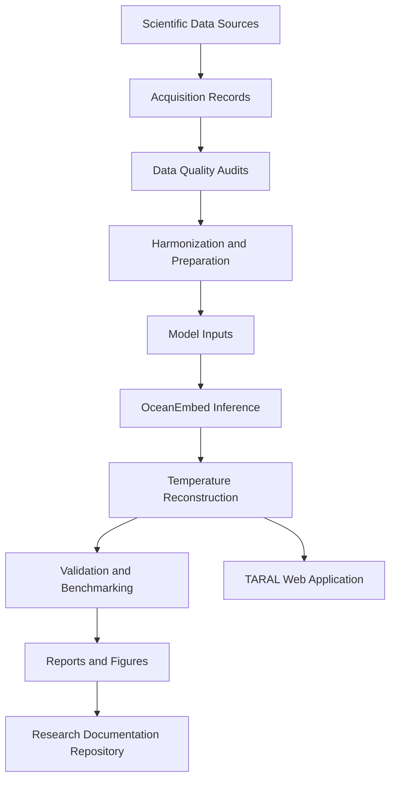

# 🌊 TARAL — OceanEmbed

### Thermal Analysis and Reconstruction using Deep Learning for Ocean Layers

**A scientific documentation and research repository for subsurface ocean temperature reconstruction, dataset provenance, model evaluation, data-quality audits, and reproducible research.**

[](#project-information)
[](#project-information)
[](#team)

**Team:** Bharat Through Space  
**Team ID:** 165933  
**Problem Statement:** SIH26066

[🌐 Live Application](https://ocean-embed-rho.vercel.app/landing) · [📊 Dataset Documentation](https://github.com/Saad-Shaikh095/TARAL/tree/main/Dataset_Documentation) · [📈 Latest Model Results](https://github.com/Saad-Shaikh095/TARAL/tree/main/Latest_Model_Research)

<!-- Replace with your actual project banner -->
<p align="center">
  
</p>

---

## 📑 Table of Contents

1. [Project Information](#-project-information)
2. [About This Repository](#-about-this-repository)
3. [Project Overview](#-project-overview)
4. [Problem Statement](#-problem-statement)
5. [Scientific Approach](#-scientific-approach)
6. [Study Region and Data Specifications](#-study-region-and-data-specifications)
7. [Dataset Catalogue](#-dataset-catalogue)
8. [Data Provenance and Acquisition](#-data-provenance-and-acquisition)
9. [Data-Quality Audit Reports](#-data-quality-audit-reports)
10. [Model Documentation](#-model-documentation)
11. [Latest Model Results](#-latest-model-results)
12. [Validation Methodology](#-validation-methodology)
13. [Scripts and Research Utilities](#-scripts-and-research-utilities)
14. [Figures and Visualizations](#-figures-and-visualizations)
15. [Research References](#-research-references)
16. [Repository Structure](#-repository-structure)
17. [Reproducibility](#-reproducibility)
18. [Limitations and Future Work](#-limitations-and-future-work)
19. [Team](#-team)
20. [Links and Resources](#-links-and-resources)
21. [License and Data Usage](#-license-and-data-usage)

---

## 📌 Project Information

| Field | Details |
|---|---|
| Project | TARAL — OceanEmbed |
| Full form | Thermal Analysis and Reconstruction using Deep Learning for Ocean Layers |
| Hackathon | Smart India Hackathon 2026 |
| Problem Statement ID | SIH26066 |
| Theme | Disaster Management |
| Category | Software |
| Team | Bharat Through Space |
| Team ID | 165933 |
| Live application | [Open TARAL](https://ocean-embed-rho.vercel.app/landing) |
| Repository purpose | Documentation, datasets, scripts, audits, and research results |

## 📖 About This Repository

This repository serves as the **central documentation and research record for TARAL / OceanEmbed**.

It is intended to preserve the scientific context, dataset information, data-quality findings, experiment records, evaluation results, and supporting research materials used throughout the project.

### What this repository contains

- Dataset catalogues, source links, metadata, and acquisition records.
- Data preparation and auditing scripts.
- Data-quality and missingness reports.
- Model architecture and configuration documentation.
- Experiment logs, benchmark comparisons, and latest evaluation results.
- Validation methodology, metrics, plots, and supporting evidence.
- Scientific references and technical documentation.
- Selected figures, reports, and research artifacts.

### What this repository does not contain

- The complete frontend source code.
- The complete backend source code.
- The full deployed application implementation.

The user-facing application is hosted separately and can be accessed through the [TARAL live application](https://ocean-embed-rho.vercel.app/landing).

> **Repository principle:** Every reported statistic or model result should be traceable to its dataset, script, configuration, evaluation procedure, or supporting report wherever possible.

## 🌊 Project Overview

TARAL is the software and research initiative associated with OceanEmbed, a deep-learning approach for reconstructing subsurface ocean temperature from surface satellite observations and complementary oceanographic data.

The research workflow brings together multi-source ocean data, data-quality auditing, harmonization, feature preparation, deep-learning inference, validation, and scientific visualization.

The repository documents the evidence and methodology behind that workflow rather than serving as the complete application codebase.

### Primary objectives

- Document the datasets used for subsurface temperature reconstruction.
- Maintain traceable records of data sources, versions, and processing.
- Identify missingness, coverage gaps, and data-quality issues.
- Record model configurations and experiment results.
- Evaluate temperature reconstruction using clearly defined metrics.
- Provide reproducible figures, reports, and scripts for research review.

## 🎯 Problem Statement

Satellite observations provide valuable information about ocean-surface conditions but do not directly reveal the full temperature structure beneath the surface.

Reconstructing subsurface temperature is challenging because of:

- Sparse and unevenly distributed in-situ observations.
- Missing data and incomplete spatial coverage.
- Differences in the resolution and temporal coverage of source datasets.
- Land–ocean boundaries and coastal data-quality issues.
- The need to estimate temperature across multiple depth levels.
- The need for reliable validation and transparent reporting.

TARAL / OceanEmbed investigates how multi-source oceanographic observations and deep-learning methods can support this reconstruction problem.

## 🧪 Scientific Approach

The documented research workflow follows these stages:

1. **Data acquisition:** Identify and retrieve relevant oceanographic datasets.
2. **Data auditing:** Examine missingness, coverage, metadata, and integrity.
3. **Data harmonization:** Align datasets to the required spatial and temporal framework.
4. **Feature preparation:** Prepare model inputs and validity masks.
5. **Model inference:** Apply the configured, trained reconstruction model.
6. **Evaluation:** Compare predictions with the selected reference observations.
7. **Documentation:** Publish results, scripts, metrics, limitations, and supporting figures.



*This diagram describes the documented research workflow. Update it if the implemented pipeline differs.*

## 🌍 Study Region and Data Specifications

| Parameter | Value reported in the project presentation |
|---|---|
| Region | North Indian Ocean |
| Latitude | 5°N–30°N |
| Longitude | 45°E–105°E |
| Spatial resolution | 0.25° |
| Grid convention | Cell-centred |
| Canonical grid | 100 × 240 |
| Data period | 2012–2024 |
| Temporal frequency | Daily, as described in the presentation |
| Validation depths | 15 levels from 0–1000 m |
| GLORYS training depths | 36 levels |

These are presentation-reported specifications. Refer to the dataset metadata and processing configuration for the authoritative values used in each experiment.


## 🗂️ Dataset Catalogue

The catalogue below summarizes the sources identified in the project presentation. Link each entry to a detailed record in the repository.

| Dataset | Scientific variable or purpose | Documentation |
|---|---|---|
| NOAA OISST v2.1 | Sea Surface Temperature | [Official documentation](https://www.ncei.noaa.gov/products/optimum-interpolation-sst) |
| NOAA OISSS v3.0 | Sea Surface Salinity | [Add exact product link](YOUR_OISSS_URL) |
| Copernicus DUACS | Sea-level and altimetry information | [Copernicus Marine](https://marine.copernicus.eu/) |
| GlobCurrent | Ocean surface-current information | [Add exact product link](YOUR_GLOBCURRENT_URL) |
| CCMP v3.1 | Surface wind information | [Add exact product link](YOUR_CCMP_URL) |
| OSCAR | Ocean surface currents | [NASA PO.DAAC](https://podaac.jpl.nasa.gov/) |
| GLORYS | Ocean reanalysis and subsurface reference fields | [Copernicus Marine](https://marine.copernicus.eu/) |
| GEBCO | Bathymetry and ocean-floor elevation | [GEBCO](https://www.gebco.net/) |
| ARGO | In-situ ocean profile observations | [ARGO Program](https://argo.ucsd.edu/) |
| Ocean hazard datasets | Additional environmental or hazard context | [Add exact source](YOUR_HAZARD_DATA_URL) |

### Dataset documentation standard

Each dataset should have a dedicated record describing:

- Dataset name and provider.
- Exact product identifier and version.
- Variables used.
- Spatial and temporal coverage.
- Native and target resolution.
- Units, coordinate system, and depth convention.
- Acquisition method and retrieval date.
- Missing-value conventions.
- Processing and harmonization steps.
- License, access restrictions, and citation requirements.
- File inventory and checksums, where available.

**Dataset index:** [`docs/datasets/`](docs/datasets/)

## 🔍 Data Provenance and Acquisition

The provenance records should explain where each input came from and how it entered the research pipeline.

| Field | Description |
|---|---|
| Source identifier | Official dataset or product name |
| Version | Product version or release |
| Retrieval date | Date the data was acquired |
| Source URL | Official download or API endpoint |
| Time range | Period represented by the downloaded data |
| Spatial subset | Region and grid used |
| Processing script | Script used to prepare or audit the data |
| Output artifact | Processed file or report produced |
| Checksum | Optional file-integrity identifier |
| License | Applicable dataset usage conditions |

**Acquisition logs:** [`docs/data-provenance/`](docs/data-provenance/)

Do not commit credentials, access tokens, or restricted data. Large datasets can be referenced through their official providers or approved storage locations.

## 🧾 Data-Quality Audit Reports

The project presentation reports these initial missingness statistics:

| Audit metric | Reported value |
|---|---:|
| OISSS missingness | 54.84% |
| DUACS SLA missingness | 48.36% |
| DUACS missing coverage associated with land | 98.60% |
| ARGO files identified | 77,000+ |
| OSCAR files audited | 4,749 |

These values are historical, presentation-reported figures. Consult the corresponding audit report for the exact date range, denominator, spatial mask, and calculation method.

### Audit categories

- Data completeness and missingness.
- Spatial and temporal coverage.
- Coordinate and grid consistency.
- Metadata and unit consistency.
- File integrity and duplicate detection.
- Land–ocean mask consistency.
- Invalid values and unexpected ranges.

### Audit report index

| Report | Purpose | Link |
|---|---|---|
| Missingness report | Quantifies missing values | [`reports/audits/missingness/`](reports/audits/missingness/) |
| Spatial coverage report | Examines geographic coverage | [`reports/audits/spatial-coverage/`](reports/audits/spatial-coverage/) |
| Data integrity report | Records file and metadata checks | [`reports/audits/integrity/`](reports/audits/integrity/) |
| Land–ocean audit | Evaluates mask consistency | [`reports/audits/land-ocean/`](reports/audits/land-ocean/) |
| Dataset inventory | Lists files and source metadata | [`reports/audits/inventory/`](reports/audits/inventory/) |

Replace these paths with the actual files and folders in the repository.

## 🧠 Model Documentation

This section records the model configurations and methodology used by the project.

| Component | Documented role |
|---|---|
| ConvLSTM | Spatiotemporal reconstruction model |
| CNN-LSTM | Alternative model architecture |
| Partial Convolution | Missingness-aware convolution method |
| Depth-specific normalization | Standardization of depth-resolved targets |
| Baselines B1–B9 | Controlled benchmarking configurations |

### Input contract

The project presentation describes a 36-channel input representation.

| Input group | Channel count |
|---|---:|
| Dynamic features | 24 |
| Static features | 6 |
| Spatial features | 4 |
| Temporal features | 2 |
| **Total** | **36** |

A 14-day input window is also described in the presentation.

The authoritative model documentation should specify the exact variable order, tensor dimensions, mask convention, normalization parameters, target depths, and model configuration used for each run.

**Model documentation:** [`docs/models/`](docs/models/)

**Model configurations:** [`configs/`](configs/)

## 📈 Latest Model Results

The project presentation reports the following ConvLSTM validation metrics:

| Metric | Reported value |
|---|---:|
| Validation RMSE | 0.704°C |
| Pearson correlation | 0.919 |

These are presentation-reported values, not a claim that the latest experiment has independently reproduced them. The newest dated evaluation report should be treated as the source of truth.

### Experiment history

| Experiment ID | Model | Dataset/version | Evaluation split | RMSE | MAE | Pearson r | Report |
|---|---|---|---|---:|---:|---:|---|
| `EXP-001` | ConvLSTM | `[Version]` | `[Split]` | 0.704°C* | `[Add]` | 0.919* | `[Link report]` |
| `EXP-002` | `[Model]` | `[Version]` | `[Split]` | `[Add]` | `[Add]` | `[Add]` | `[Link report]` |

`*` Historical value reported in the project presentation; replace it with the verified result from the relevant experiment.

<p align="center">
  
</p>

### Result artifacts

- Latest evaluation report: [`reports/results/latest/`](reports/results/latest/)
- Historical benchmark results: [`reports/results/benchmarks/`](reports/results/benchmarks/)
- Evaluation scripts: [`scripts/evaluation/`](scripts/evaluation/)
- Result figures: [`assets/results/`](assets/results/)


### Required experiment metadata

Every published result should identify:

- Experiment ID and timestamp.
- Model architecture and checkpoint version.
- Dataset versions and preprocessing configuration.
- Training, validation, and test split.
- Evaluation target and independent validation source.
- Number of valid observations.
- Overall and depth-wise metrics.
- Random seed and hardware, where applicable.
- Script or notebook used to generate the result.
- Known limitations and unresolved discrepancies.

## 🛠️ Scripts and Research Utilities

This repository may contain standalone scripts and notebooks for data inspection, quality auditing, metadata extraction, evaluation, visualization, and reproducibility.

| Directory | Intended contents |
|---|---|
| `scripts/acquisition/` | Dataset acquisition utilities and retrieval logs |
| `scripts/audit/` | Missingness, integrity, coverage, and mask checks |
| `scripts/preprocessing/` | Dataset harmonization and preprocessing utilities |
| `scripts/evaluation/` | Metric calculation and validation routines |
| `scripts/visualization/` | Plotting and report-generation scripts |
| `notebooks/` | Exploratory analysis and research experiments |

These are suggested categories. Keep only folders and scripts that actually exist.

For each script, document its purpose, required inputs, expected outputs, dependencies, command-line arguments, and limitations. Do not include invented commands or imply that a script exists before it is committed.

## 🖼️ Figures and Visualizations

The repository should preserve figures that explain the scientific method and support published results.

Recommended figures include:

- Study-region and spatial-grid maps.
- Dataset missingness and coverage maps.
- Land–ocean mask visualizations.
- Model architecture diagrams.
- Observed-versus-predicted temperature plots.
- RMSE and MAE by depth.
- Regional validation maps.
- Bay of Bengal and Arabian Sea case studies.

Every figure should include a descriptive caption, source or generation script, experiment ID where relevant, and the date it was generated.

## 📚 Research References

The presentation lists these author-year references. Verify their full bibliographic details before using them as formal citations.

| Citation listed in the presentation | Topic |
|---|---|
| Shi et al. (2015) | ConvLSTM |
| Liu et al. (2018) | Partial Convolution |
| Wang et al. (2021) | Multisource subsurface temperature reconstruction |
| Su et al. (2022) | ConvLSTM-based reconstruction |
| Li et al. (2025) | Vertical temperature-profile reconstruction |
| Zhao et al. (2025) | Deep learning and physical guidance for temperature/salinity reconstruction |

**Reference library:** [`docs/references/`](docs/references/)

Add the exact paper title, author list, publication venue, year, DOI, and official URL for each reference.

## 📁 Repository Structure

Suggested documentation-first structure:

```text
TARAL-OceanEmbed/
├── README.md
├── LICENSE
├── CITATION.cff
├── CHANGELOG.md
├── assets/
│   ├── project-banner.png
│   ├── study-region.png
│   └── results/
├── docs/
│   ├── datasets/
│   ├── data-provenance/
│   ├── models/
│   ├── methodology/
│   └── references/
├── configs/
│   └── README.md
├── scripts/
│   ├── acquisition/
│   ├── audit/
│   ├── preprocessing/
│   ├── evaluation/
│   └── visualization/
├── notebooks/
├── reports/
│   ├── audits/
│   ├── results/
│   └── figures/
└── data/
    └── README.md
```

This is a proposed structure, not a claim about the current repository contents. Modify it to match the files you actually maintain.

## 🔁 Reproducibility

The repository aims to make the research process auditable and repeatable.

For each experiment, preserve the relevant metadata, dataset versions, configuration, scripts, evaluation outputs, and figures.

When large files or datasets cannot be hosted directly in GitHub, provide stable source links, checksums, access instructions, and clear version information.

Avoid committing secrets, large generated artifacts without a clear reason, or third-party datasets whose licenses do not permit redistribution.

## ⚠️ Limitations and Future Work

Potential research directions include:

- Improving independent validation against in-situ observations.
- Reporting depth-wise and regional performance.
- Documenting uncertainty and quality flags.
- Resolving differences between reported evaluation metrics.
- Improving data-quality monitoring and provenance tracking.
- Expanding regional coverage only after appropriate validation.
- Publishing reproducible benchmarks and case studies.

Subsurface reconstruction estimates should not be treated as direct measurements at every grid cell. The system should not be described as a standalone operational disaster-warning system without dedicated validation.

## 👥 Team

**Bharat Through Space**  
Smart India Hackathon 2026 · Team ID 165933 · Problem Statement SIH26066

| Member | Responsibility | Profile |
|---|---|---|
| Lalit Hire | Backend | `[GitHub / LinkedIn]` |
| Amit Joshi | Backend | `[GitHub / LinkedIn]` |
| Lochana Pawar | Backend | `[GitHub / LinkedIn]` |
| Saad Shaikh | Backend | `[GitHub / LinkedIn]` |
| Rushikesh Bhavar | Frontend | `[GitHub / LinkedIn]` |
| Akshata | Frontend | `[GitHub / LinkedIn]` |

## 🔗 Links and Resources

| Resource | Link |
|---|---|
| Live TARAL application | [Open application](https://ocean-embed-rho.vercel.app/landing) |
| GitHub documentation repository | [Open Documentation](https://github.com/Saad-Shaikh095/TARAL/tree/main/Documentation) |
| Dataset documentation | [Open dataset documentation](https://github.com/Saad-Shaikh095/TARAL/blob/main/Dataset%20Documentation) |
| Latest model results | [Open latest model results](https://github.com/Saad-Shaikh095/TARAL/tree/main/Latest%20Model%20Result) |
| Audit reports | [Audit Reports](https://github.com/Saad-Shaikh095/TARAL/tree/main/Audit_reports) |
| Research references | [Researche And references](docs/references/) |
| Presentation | `[Add PPT/PDF URL]` |

## 📄 License and Data Usage

Choose a repository license and include the corresponding license file before claiming the project is distributed under that license.

Third-party datasets may have separate access, citation, and redistribution terms. Follow the terms of each data provider, and do not assume that a software license applies to external datasets.

---

<div align="center">

**TARAL — Turning multi-source ocean observations into depth-resolved subsurface insight.**

*Smart India Hackathon 2026 · Bharat Through Space*

</div>