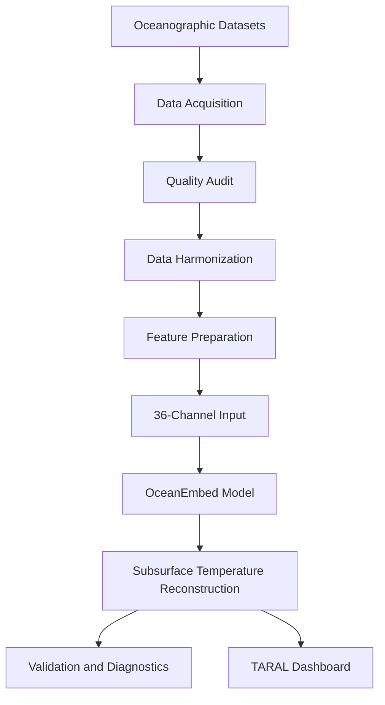

# 🌊 TARAL — OceanEmbed

**Thermal Analysis and Reconstruction using Deep Learning for Ocean Layers**

OceanEmbed-powered subsurface ocean intelligence for disaster analysis and warning support.

| Project detail | Information |
|---|---|
| Hackathon | Smart India Hackathon 2026 |
| Problem Statement ID | SIH26066 |
| Problem Statement | Satellite Embedding-Based Deep Learning Framework for Reconstruction of Subsurface Ocean Temperature from Surface Satellite Observations |
| Theme | Disaster Management |
| Category | Software |
| Team | Bharat Through Space |
| Team ID | 165933 |

<!-- Add your project banner here -->


[Live Demo](https://ocean-embed-rho.vercel.app/landing) · [GitHub Repository](YOUR_REPOSITORY_URL) · [Dataset Documentation](YOUR_DATASET_DOCS_URL)

---

## 📌 Table of Contents

1. Project Overview
2. Problem Statement
3. Proposed Solution
4. Key Features
5. System Architecture
6. Data Sources
7. Study Region
8. Data Quality
9. Deep Learning Framework
10. Model Performance
11. Dashboard
12. Technology Stack
13. Installation and Usage
14. Applications and Impact
15. Limitations and Future Scope
16. Research References
17. Team
18. License

---

## 1. Project Overview

TARAL is a software workflow built around OceanEmbed, a deep-learning framework designed to reconstruct subsurface ocean temperatures using surface observations and multiple oceanographic datasets.

The system aims to combine data acquisition, quality auditing, preprocessing, model inference, validation, and visualization in one reusable workflow.

**Primary objectives:**
- Reconstruct temperature profiles across multiple ocean depths.
- Integrate heterogeneous ocean datasets.
- Handle missing data and land–ocean boundaries.
- Evaluate reconstruction accuracy using defined validation procedures.
- Visualize depth-resolved temperature information.
- Explore anomaly analysis and downstream hazard decision support.

## 2. Problem Statement

Surface satellite observations do not directly provide a complete temperature profile beneath the ocean surface. Subsurface temperature information is valuable for studying ocean stratification, thermal variability, circulation, and other ocean processes.

The project addresses the challenge of estimating subsurface temperature from surface observations while accounting for missing data, spatial and temporal differences, and limited in-situ measurements.

## 3. Proposed Solution

TARAL provides a workflow for:

1. Acquiring oceanographic datasets.
2. Auditing coverage, missingness, and data integrity.
3. Harmonizing datasets onto a common spatial and temporal framework.
4. Preparing features and validity masks.
5. Running the trained OceanEmbed model.
6. Reconstructing subsurface temperatures.
7. Comparing predictions with reference observations.
8. Visualizing results through a dashboard.

> Update this section to distinguish implemented capabilities from planned features.

## 4. Key Features

| Feature | Description |
|---|---|
| Automated data pipeline | Acquire, audit, harmonize, prepare, and infer. |
| Multi-source data integration | Combine thermal, salinity, sea-level, current, wind, and terrain information. |
| Missing-data handling | Use validity masks and Partial Convolution where implemented. |
| Ocean-aware processing | Account for land–ocean boundaries. |
| Depth-resolved reconstruction | Estimate temperature across multiple depths. |
| Coordinate-based analysis | Inspect supported locations through TARAL. |
| Model evaluation | Report defined validation metrics and depth-wise errors. |
| Visualization | Present maps, profiles, and data-quality information. |

## 5. System Architecture

<!-- Replace with the real architecture image -->




## 6. Data Sources

| Dataset | Purpose |
|---|---|
| NOAA OISST v2.1 | Sea Surface Temperature |
| NOAA OISSS v3.0 | Sea Surface Salinity |
| Copernicus DUACS | Sea level and altimetry |
| GlobCurrent | Ocean surface currents |
| CCMP v3.1 | Surface winds |
| OSCAR | Ocean currents and validation context |
| GLORYS | Subsurface temperature training/reference field |
| GEBCO | Bathymetry and ocean mask |
| ARGO | In-situ observations and independent validation |
| Ocean hazard data | Hazard context |

Dataset documentation: [NOAA](https://www.ncei.noaa.gov/), [Copernicus Marine](https://marine.copernicus.eu/), [GEBCO](https://www.gebco.net/), [ARGO](https://argo.ucsd.edu/).

Add the exact product URLs, versions, access methods, licenses, and download dates used by the project.

## 7. Study Region

| Parameter | Value from project presentation |
|---|---|
| Region | North Indian Ocean |
| Latitude | 5°N–30°N |
| Longitude | 45°E–105°E |
| Spatial resolution | 0.25° |
| Grid convention | Cell-centred |
| Validation depths | 15 levels from 0–1000 m |
| GLORYS training depths | 36 depth levels |
| Canonical grid | 100 × 240 |
| Data period | 2012–2024 |
| Temporal frequency | Daily, as described in the presentation |


Verify these specifications against the actual dataset metadata and preprocessing configuration.

## 8. Data Quality

The presentation reports the following data-quality statistics:

| Measure | Reported value |
|---|---:|
| OISSS missingness | 54.84% |
| DUACS SLA missingness | 48.36% |
| DUACS missing coverage associated with land | 98.60% |

The auditing workflow considers coverage, missingness, integrity, land–ocean consistency, and grid compatibility.

Document the calculation method, denominator, date range, and masks used for each statistic.

## 9. Deep Learning Framework

### Models and methods

| Component | Purpose |
|---|---|
| ConvLSTM | Spatiotemporal temperature reconstruction |
| CNN-LSTM | Alternative model architecture |
| PartialConv | Missingness-aware convolution |
| Depth-specific normalization | Target standardization |
| Baselines B1–B9 | Controlled model benchmarking |

### 36-channel input contract

| Input group | Channels |
|---|---:|
| Dynamic features | 24 |
| Static features | 6 |
| Spatial features | 4 |
| Temporal features | 2 |
| **Total** | **36** |

The presentation also describes a 14-day input window. Add the exact feature names, channel order, tensor dimensions, mask conventions, and normalization procedure from the code.

## 10. Model Performance

The presentation reports the following ConvLSTM results:

| Metric | Reported result |
|---|---:|
| Validation RMSE | 0.704°C |
| Pearson correlation | 0.919 |

These values should be reproduced from the evaluation code before publication as verified results.

For reproducibility, document:
- Training, validation, and test splits.
- Reference dataset and independent validation source.
- Number of valid samples.
- Metric aggregation across locations and depths.
- RMSE, MAE, bias, and correlation by depth.
- Any unresolved discrepancies between evaluation reports.


## 11. TARAL Dashboard

TARAL is intended to connect data preparation and model inference with a user-facing visualization workflow.

<!-- Replace the images below with actual application screenshots -->


Document the actual steps required to select a location, execute inference, view a depth profile, inspect quality flags, and export results.

## 12. Technology Stack

The presentation lists the following technologies. Confirm actual usage before finalizing this table.

| Area | Technologies |
|---|---|
| Programming | Python, JavaScript, TypeScript |
| Data processing | NumPy, Pandas |
| Machine learning | scikit-learn, TensorFlow, PyTorch |
| Scientific data | netCDF |
| Visualization | Plotly, Matplotlib, Seaborn |
| Development | Jupyter, VS Code |
| Training | Kaggle GPU |
| Styling | CSS |
| Version control | GitHub |

## 13. Installation and Usage

> Replace these placeholders with commands verified against the repository.

### Prerequisites

- Python: `YOUR_SUPPORTED_VERSION`
- Git
- pip or conda
- Required CPU/GPU environment
- Dataset access configuration, if required

### Clone the repository

```bash
git clone YOUR_REPOSITORY_URL
cd YOUR_REPOSITORY_FOLDER
```

### Create a virtual environment

```bash
python -m venv .venv
```

Activate on Windows:

```bat
.venv\Scripts\activate
```

Activate on macOS/Linux:

```bash
source .venv/bin/activate
```

### Install dependencies

```bash
pip install -r requirements.txt
```

### Configure the application

```bash
# Copy the example configuration and edit it as documented
copy .env.example .env
```

Use `cp .env.example .env` on macOS/Linux. Never commit credentials or private API keys.

### Run the application

```bash
YOUR_ACTUAL_APPLICATION_START_COMMAND
```

### Run model inference

```bash
YOUR_ACTUAL_INFERENCE_COMMAND
```

Replace the example commands with the actual scripts and supported arguments from the repository.

## 14. Applications and Impact

| Application | Potential value |
|---|---|
| Ocean monitoring | Depth-resolved thermal information |
| Oceanographic research | Analysis of thermal structure and variability |
| Disaster decision support | Additional environmental context for hazard analysis |
| Maritime environmental assessment | Subsurface thermal and sound-speed context |
| Fisheries and marine economy | Ocean-state information for research and decisions |
| Reproducible science | Repeatable data contracts and controlled benchmarks |

The project presentation includes illustrative estimates related to potential grid-depth predictions, global ARGO profiles, observing costs, and India's fisheries and marine economy. Cite the original sources and explain the assumptions before publishing those figures.

**Important:** Temperature reconstruction and anomaly analysis should not be described as a standalone operational disaster-warning system without specific validation.

## 15. Limitations and Future Scope

Potential limitations include missing or unevenly distributed observations, regional differences in model accuracy, uncertainty at deeper levels, and differences between training targets and independent observations.

Potential future work:
- Improve independent validation.
- Report depth-wise and regional error metrics.
- Add uncertainty estimates and quality flags.
- Evaluate additional model architectures.
- Improve automated data monitoring.
- Expand regional coverage after validation.
- Integrate validated anomaly analysis into downstream workflows.

Mark each item as planned, in progress, or completed according to the actual project status.

## 16. Research References

The presentation lists these research citations by author and year. Verify their exact titles, venues, and DOI/URLs before publication.

| Citation listed | Topic |
|---|---|
| Shi et al. (2015) | ConvLSTM |
| Liu et al. (2018) | Partial Convolution |
| Wang et al. (2021) | Multisource subsurface temperature reconstruction |
| Su et al. (2022) | ConvLSTM-based temperature reconstruction |
| Li et al. (2025) | Vertical temperature-profile reconstruction |
| Zhao et al. (2025) | Deep learning and physical guidance for temperature/salinity reconstruction |

## 17. Links and Resources

| Resource | URL |
|---|---|
| Live prototype | `YOUR_DEMO_URL` |
| GitHub repository | `YOUR_REPOSITORY_URL` |
| Dataset documentation | `YOUR_DATASET_DOCS_URL` |
| Collected datasets | `YOUR_DATASET_STORAGE_URL` |
| Demo video | `YOUR_VIDEO_URL` |
| Presentation | `YOUR_PRESENTATION_URL` |

## 18. Team

**Bharat Through Space**  
Smart India Hackathon 2026 · Team ID 165933 · Problem Statement 26066

| Member | Role | Contributions | Profile |
|---|---|---|---|
| `Lalit Hire` | `Backend` | `Contribution` | `GitHub/LinkedIn` |
| `Amit Joshi` | `Backend` | `Contribution` | `GitHub/LinkedIn` |
| `Lochana Pawar` | `Backend` | `Contribution` | `GitHub/LinkedIn` |
| `Saad Shaikh` | `Backend` | `Contribution` | `GitHub/LinkedIn` |
| `Rushikesh Bhavar` | `Frontend` | `Contribution` | `GitHub/LinkedIn` |
| `Akshata` | `Frontend` | `Contribution` | `GitHub/LinkedIn` |

## License

`Choose a license and add the corresponding LICENSE file.`

Check the terms of third-party datasets separately; a software license does not automatically cover external data.

---

<div align="center">

**TARAL — Turning multi-source ocean observations into depth-resolved subsurface insight.**

Smart India Hackathon 2026 · Bharat Through Space

</div>
